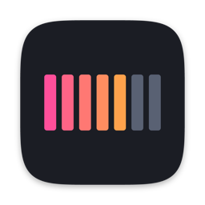

# kit

Declarative setup for your Macs.

Still rebuilding your Mac from a dotfiles repo and a pile of scripts? kit does it from one private repository: your apps, settings, files and data, on every Mac you own. And it's built agent-first: Claude, or any agent, runs it with the same commands you do.

A blank Mac is one pasted line away: sign in to GitHub on your phone, and kit installs everything and copies your data across from the Mac it replaces. Secrets come from 1Password, never the repository. Change something by hand and kit shows you, to keep or put back, and every night it saves your apps' settings without being asked.

[Docs](docs/README.md) · [Commands](docs/commands.md) · [Configuration](docs/configuration.md) · [Glossary](docs/glossary.md)

## What you get

- **A new Mac from one line.** The boot installs Homebrew, your terminal and kit-config, then
  carries on in that terminal. If a step fails, paste the line again to pick up where it
  stopped. [A new Mac](docs/new-mac.md)
- **Built for agents.** `kit agent` gives Claude the rules for changing your Mac, and every
  command that checks or changes something answers in JSON with `--json`.
  [Agents](docs/agents.md)
- **Drift you can keep or undo.** A package you installed with brew shows up in `kit status`
  after a day, and `kit reconcile` declares it or uninstalls it. [Drift](docs/drift.md)
- **Everything you install, declared.** `kit brew add jq` installs jq and declares it in
  kit-config, across nine kinds from Homebrew casks to Claude Code skills.
  [Packages](docs/packages.md)
- **macOS settings, and your apps'.** `kit defaults add com.apple.dock:tilesize` keeps the Dock
  size you set, and with `kit feature on prefs` the nightly run saves your apps' settings.
  [Settings](docs/settings.md)
- **Secrets from 1Password.** kit-config holds only where each token is kept. Each Mac gets
  the token as a shell variable or a file, never printed. [Secrets](docs/secrets.md)

More: [Linked files](docs/linked-files.md) · [Your data](docs/your-data.md) ·
[Steps](docs/steps.md) · [Running by itself](docs/running-by-itself.md) ·
[Backups](docs/backups.md)

## How a Mac stands

`kit status` runs every check, and says what needs you and the command that settles it:

```console
  █  ▄▀  ▀█▀  ▀▀█▀▀  │  status
  █▀▀▄    █     █    │  laptop
  █   █  ▄█▄    █    │  Fri 2 Jan · 03:04

  BACKUPS
  ● Time Machine  last backup 02:35

  CONFIG
  ▲ jq  declared, not installed · → kit apply
  ▲ ffmpeg  installed, not declared · 2 days · → kit reconcile
  ● Packages  7 installed · 1 new
  ● Settings  9 set
  ● kit-config  private

  STEPS
  ● fonts  16 installed
```

## Install

You need macOS 13 or later, on Apple silicon or Intel, and a GitHub account. 1Password is
needed only for secrets.

```bash
# On a Mac with Homebrew
brew install leeovery/tools/kit
```

```bash
# On a blank Mac: the boot, in Terminal
/bin/bash -c "$(curl -fsSL \
https://raw.githubusercontent.com/leeovery/kit/main/install.sh)"
```

kit has no uninstall command. `brew uninstall kit` leaves the hourly launch in
`~/Library/LaunchAgents`, kit.app and state under `~/.local`, and logs in `~/Library/Logs/kit`.

## Quick start

This assumes you have a kit-config. To make your first one, see
[Your first kit-config](docs/first-config.md) (coming).

```bash
# Clone kit-config where kit reads it
gh repo clone owner/kit-config ~/.config/kit
# Name this Mac, as kit.toml names it
kit machine laptop
# See how this Mac stands against kit-config
kit status
# Install what's declared and missing
kit apply
```

`kit apply` installs and sets what kit-config declares, and never removes anything.

## Questions

- **I have one Mac.** kit.toml can name a single Mac, and a reinstall rebuilds it from kit-config
  and its own backups. [Your data](docs/your-data.md)
- **I don't use 1Password.** kit runs without it, until you declare a secret.
  [Secrets](docs/secrets.md)
- **I install things by hand.** They show up as drift after a day, for you to keep or remove.
  [Drift](docs/drift.md)
- **Can an agent break my Mac?** kit's guide tells it to ask you before it removes anything,
  and your password and sign-ins stay with you. [Agents](docs/agents.md)
- **Is kit-config public?** Never: the boot stops at a public kit-config, and `kit status`
  flags one. [Troubleshooting](docs/troubleshooting.md)

## Where next

- [The docs](docs/README.md), grouped by the job in front of you.
- [Commands](docs/commands.md): every command, and the page that covers it.
- [Configuration](docs/configuration.md): kit-config file by file.
- [Troubleshooting](docs/troubleshooting.md): what kit says when something's wrong.

To work on kit, read [the design](docs/design.md) and [CLAUDE.md](CLAUDE.md).

## Licence

MIT: see [LICENSE](LICENSE).
