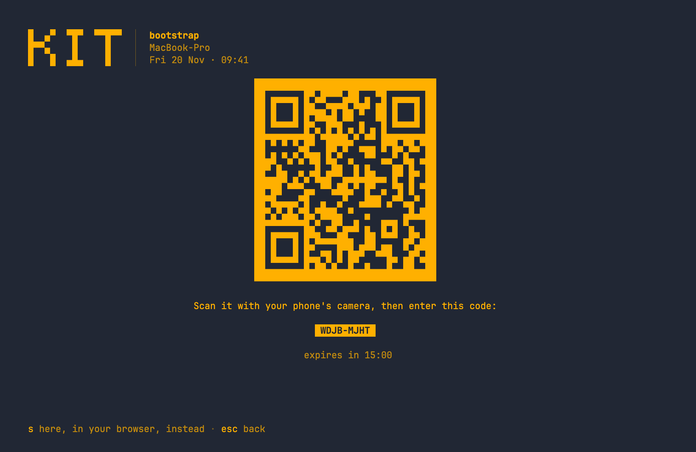
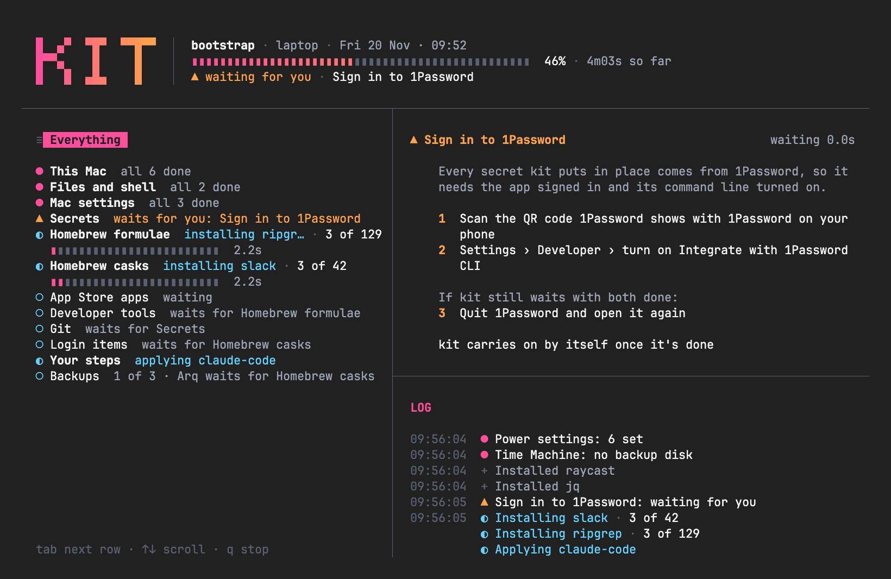
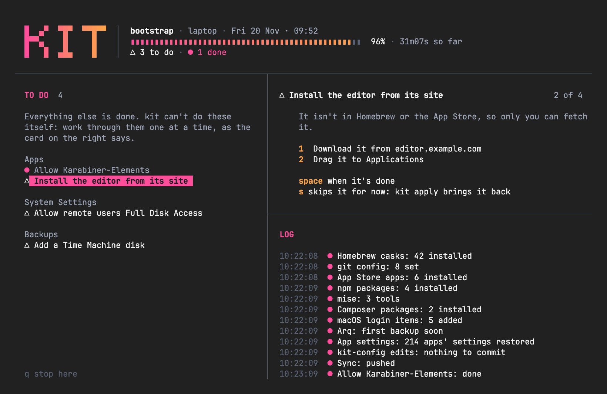
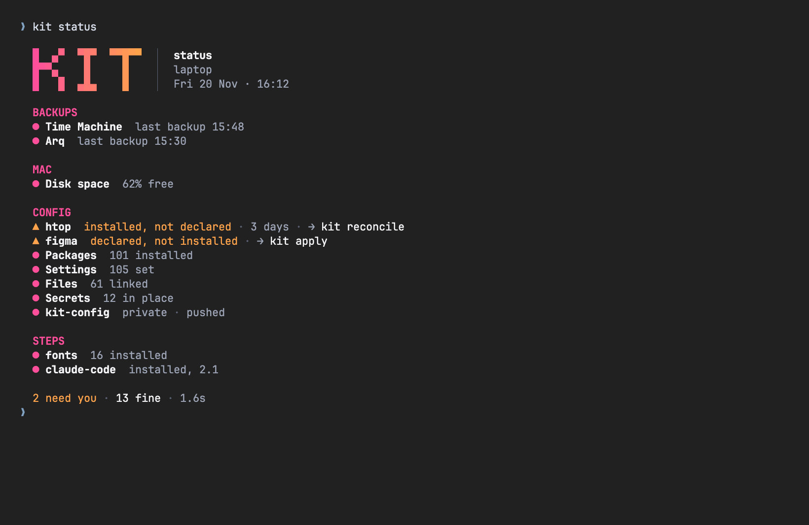
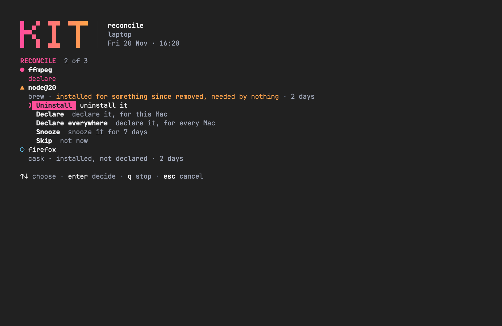

<div align="center">


# kit

**Declarative setup for your Macs.**

Still rebuilding your Mac from a dotfiles repo and a pile of scripts? kit does it from one private repository: your apps, settings, files and data, on every Mac you own. And it's built agent-first: Claude, or any agent, runs it with the same commands you do.

A blank Mac is one pasted line away: sign in to GitHub on your phone, and kit installs everything and copies your data across from the Mac it replaces. Secrets come from 1Password, never the repository. Change something by hand and kit shows you, to keep or put back, and every night it saves your apps' settings without being asked.

[](LICENSE)
[](https://go.dev)
[](#install)

[Docs](docs/README.md) · [Commands](docs/commands.md) · [Configuration](docs/configuration.md) · [Troubleshooting](docs/troubleshooting.md)


</div>

---

## Why kit?

- **A new Mac from one line.** The boot installs Homebrew, your terminal, kit-config and kit,
  and pasting the line again after a failure picks up where it stopped.
  [A new Mac](docs/new-mac.md)
- **Built for agents.** `kit agent` gives Claude the rules for changing your Mac, and every
  command that checks or changes something answers in JSON with `--json`.
  [Agents](docs/agents.md)
- **Drift you can keep or undo.** A package you installed with brew gets its own line in
  `kit status` after a day, and `kit reconcile` declares it or uninstalls it. [Drift](docs/drift.md)
- **Everything you install, declared.** `kit brew add jq` installs jq and declares it in
  kit-config, across nine kinds, from Homebrew formulae to Claude's skills.
  [Packages](docs/packages.md)
- **macOS settings, kept.** `kit defaults add com.apple.dock:tilesize` keeps the Dock size you
  set, on every Mac it's declared for. [Settings](docs/settings.md)
- **Secrets from 1Password.** kit-config holds only where each secret is kept, and each Mac
  gets the value as a shell variable or file, never printed. [Secrets](docs/secrets.md)

More: [Linked files](docs/linked-files.md) · [Your data](docs/your-data.md) ·
[Steps](docs/steps.md) · [Running by itself](docs/running-by-itself.md) ·
[Backups](docs/backups.md)

## Screens

|  |  |
|:---:|:---:|
| <a href="docs/new-mac.md"></a><br>**The boot**<br>A new Mac, signed in from your phone | <a href="docs/new-mac.md"></a><br>**kit apply**<br>What needs you, as a card |
| <a href="docs/steps.md"></a><br>**To-dos**<br>What only you can do, one at a time | <a href="docs/drift.md"></a><br>**kit status**<br>How this Mac stands |
| <a href="docs/drift.md"></a><br>**kit reconcile**<br>Keep or undo what changed by hand |  |

## Install

You need macOS 15 or later on Apple silicon, the Macs Homebrew supports. On an Intel Mac,
Homebrew gives only its best effort. You also need a GitHub account holding a private
kit-config, and the GitHub CLI (`gh`) signed in to it. 1Password is needed only for secrets.

```bash
# On a Mac with Homebrew
brew install leeovery/tools/kit
```

```bash
# On a blank Mac: the boot, in Terminal
/bin/bash -c "$(curl -fsSL \
https://raw.githubusercontent.com/leeovery/kit/main/install.sh)"
```

kit has no uninstall command. Before `brew uninstall kit`, delete
`~/Library/LaunchAgents/com.leeovery.kit.nightly.plist`, or launchd keeps opening kit.app every
hour. Uninstalling kit leaves:

- what kit installed and set on the Mac;
- kit-config's clone in `~/.config/kit`, and the links into it from your home folder;
- kit.app and kit's state, in `~/.local/share/kit` and `~/.local/state/kit`;
- the values of your secrets, in `~/.secrets.zsh` and their files;
- the logs, in `~/Library/Logs/kit`.

## Quick start

This assumes you have a kit-config. To make your first one, see
[Your first kit-config](docs/first-config.md) (coming).

```bash
# Clone kit-config where kit reads it
gh repo clone owner/kit-config ~/.config/kit
# Name this Mac, as kit.toml names it
kit machine laptop
# See how this Mac stands against kit-config
kit status
# Install what's declared and missing
kit apply
```

`kit apply` installs and sets what kit-config declares, and never removes anything.

## Questions you may have

- **I have one Mac.** kit.toml can name a single Mac, and a reinstall rebuilds it from kit-config
  and its own backups. [Your data](docs/your-data.md)
- **I don't use 1Password.** kit runs without it until you declare a secret, and 1Password is
  the one store today.
  [Secrets](docs/secrets.md)
- **I install things by hand.** They show up as drift after a day, for you to keep or remove.
  [Drift](docs/drift.md)
- **Can an agent break my Mac?** kit's guide tells it to ask you before it removes anything.
  Installs that need your password wait for you at a terminal, and sign-ins are yours. [Agents](docs/agents.md)
- **Is my kit-config public?** It must be private: the boot stops at a public kit-config, and
  `kit status` flags one. [Troubleshooting](docs/troubleshooting.md)

## Where next

- [The docs](docs/README.md), grouped by the job in front of you.
- [Commands](docs/commands.md): every command, and the page that covers it.
- [Configuration](docs/configuration.md): kit-config file by file.
- [Troubleshooting](docs/troubleshooting.md): what kit says when something's wrong.

To work on kit, read [the design](docs/design.md) and [CLAUDE.md](CLAUDE.md).

## License

MIT: see [LICENSE](LICENSE).
