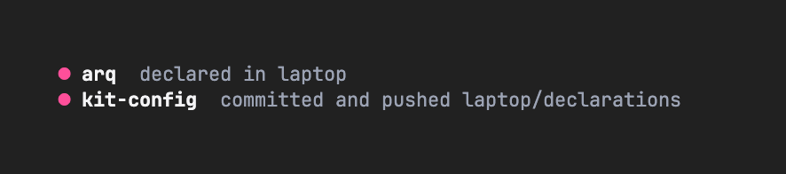
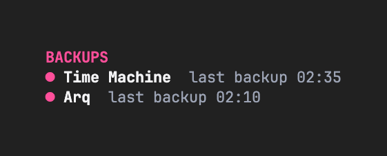
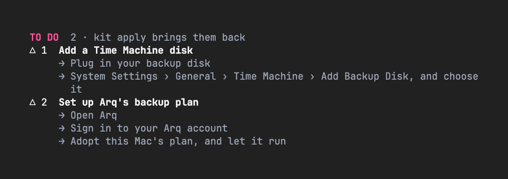

# Backups that kit checks

Name the backup tools a Mac uses, Time Machine and Arq, and `kit status` says when a backup is
late, stuck or never set up. One list of exclusions keeps the folders you name out of Time
Machine, and out of Arq once its plan follows that list. You'd want it on every Mac whose data you can't lose.

## Try it

```bash
# Check Time Machine, on every Mac
kit backup add time-machine --shared
# Check Arq, on this Mac
kit backup add arq
# Leave a folder out of the backups
kit backup-exclusion add '~/Downloads'
```

kit declares each one, then commits and pushes kit-config. Adding Arq looks like this:



The lines land in this Mac's declarations file:

```text
[backups]
arq

[backup exclusions]
~/Downloads
```

## What happens

`kit status` checks each tool under BACKUPS:



- **Every check, every hour.** The hourly run checks the tools too, and `kit status` shows what
  it found.
- **Each problem says what to do,** such as connecting the backup disk.
- **Manual plans don't count.** Arq plans set to Manual never run by themselves, so kit leaves
  them out.

A tool needs attention when:

| Tool | Needs attention when |
|---|---|
| Time Machine | Automatic backups are off |
| Time Machine | The last backup is over 3 hours old |
| Time Machine | A backup is stuck in one phase over 3 hours |
| Arq | A plan on a schedule hasn't backed up in 26 hours |
| Arq | No plan runs on a schedule |

## Setting up is yours

kit can't add a backup disk or sign in to Arq. If Time Machine has no disk, or Arq has no plan,
`kit apply` shows it as a to-do with each step:



kit watches for it, and moves on once it's done. If kit-config declares the `arq` cask, Arq is
checked after the cask installs. Otherwise kit says to run `kit cask add arq`.

## Exclusions live in Time Machine's list

kit keeps every path in `[backup exclusions]` out of the backups through `tmutil`, in the list
Time Machine keeps. It does that even on a Mac where Time Machine has never been set up.

Arq keeps no list of its own for kit to write. It leaves out what Time Machine's list holds
only if its plan has "Skip items excluded by Time Machine rules" turned on. Turn that on in Arq:
kit doesn't check it.

A line is a path or a pattern:

| Line | How kit excludes it |
|---|---|
| `~/Downloads` | By its path, even before the folder exists |
| `~/Code/*/node_modules` | Each folder that matches, where it is now |

A plain path needs your administrator's password, which `kit apply` asks for at a terminal.
Matches of a pattern need none, so the hourly run keeps a new match out within the hour.

## Exclusions wait for Full Disk Access

`tmutil` changes the list only for an app with Full Disk Access. Without it, kit holds the
exclusions and asks for the access once:

| Where kit runs | What kit asks |
|---|---|
| A terminal | Give it Full Disk Access, then reopen it |
| Over SSH | Allow Full Disk Access for remote users |
| The hourly run | Give kit.app Full Disk Access |

At a terminal, the step's last line is `kit apply backup-exclusion`. Run it in the reopened
terminal.

## Good to know

- **Exclusions need a tool.** If `[backups]` names none, the exclusions fail, saying so.
- **The data restore leaves them out too.** A path in `[backup exclusions]` never comes across
  to a new Mac.
- **An exclusion added in Time Machine's settings is drift.** `kit reconcile` asks whether to
  declare it or stop excluding it.
- **Quote the path** when you add it, such as `'~/Code/*/node_modules'`. Your shell then
  leaves the `~` and the `*` for kit.

## Reference

| Command | What it does |
|---|---|
| `kit backup add <tool>` | Checks `time-machine` or `arq` |
| `kit backup remove <tool>` | Stops checking it |
| `kit backup-exclusion add <path>` | Leaves a path out of backups |
| `kit backup-exclusion remove <path>` | Puts it back in |
| `kit status time-machine arq` | Checks only the backups |

Each `add` takes `--shared` and `--note`, and `--help` says more.

## Related

- [Your data on a new Mac](your-data.md)
- [Running by itself: the hourly run](running-by-itself.md)
- [Drift: keep or undo what changed by hand](drift.md)
