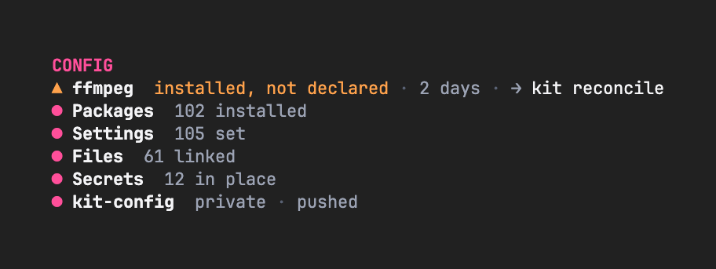
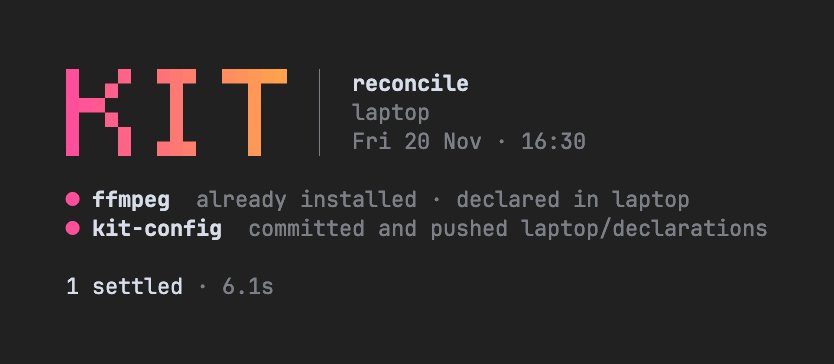
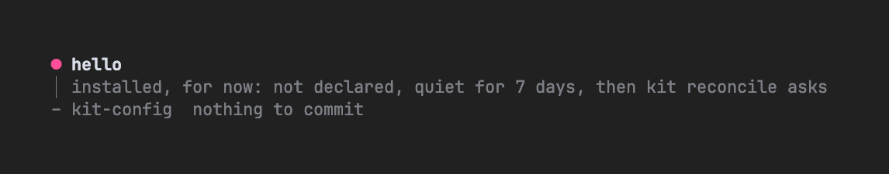

# Drift: keep or undo what changed by hand

You install a package with brew, or change a Dock setting, or an app replaces a linked file.
kit sees each one, and `kit reconcile` asks what you want. You keep it, and kit declares it in
kit-config; or you undo it, and the Mac goes back to what kit-config says. You'd want it so
that your next Mac matches the one you use today.

## Try it

```bash
# See how this Mac stands, drift included
kit status
```

Drift shows under CONFIG, with its age:



```bash
# Settle it: kit asks, then does it all
kit reconcile
```

At a terminal, kit asks about each item first. Then it does what you chose, and commits and
pushes kit-config once:



## What happens

- **A day's grace.** Drift counts only after a day. A package you try and remove the same
  afternoon never needs you. Until then, `kit status` counts it as new.
- **Every hour, kit looks.** The hourly run runs every check, so drift turns up unasked. It tells no one: `kit status` shows it.
- **One commit for the lot.** Whatever you settle in one run goes into kit-config as one
  commit, pushed.
- **Nothing is lost by stopping.** If you stop part way, kit does what you answered so far.
  Cancel, and nothing changes.

## Settling by id

Without a terminal, `kit reconcile` asks nothing. It lists each item with its id and the
answers it takes:

```text
kit reconcile · laptop
brew:ffmpeg extra since 31 Dec: --adopt, --remove or --snooze
brew:node@20 unused-dependency since 31 Dec: --remove, --adopt or --snooze
cask:firefox extra since 31 Dec: --adopt, --remove or --snooze
```

Name the ids, and one answer:

```bash
# Declare both, for this Mac
kit reconcile brew:ffmpeg cask:firefox --adopt
# Quiet another for 7 days
kit reconcile brew:node@20 --snooze
```

The answers:

| Answer | What kit does |
|---|---|
| `--adopt` | Declares what this Mac has |
| `--revert` | Puts back what was there, or what's declared |
| `--remove` | Uninstalls it |
| `--install` | Installs it, as declared |
| `--undeclare` | Takes its line out |
| `--leave` | Leaves it installed by hand, for good |
| `--snooze` | Quiets it for 7 days |

Each item takes only some, and `--snooze` takes any:

| If the item is | It takes |
|---|---|
| Installed, not declared | `--adopt`, `--remove` |
| An unused dependency | `--remove`, `--adopt` |
| Declared, not installed | `--install`, `--undeclare` |
| A setting changed on the Mac | `--adopt`, `--revert` |
| A setting set otherwise | `--install`, `--adopt` |
| A replaced linked file | `--adopt`, `--revert` |
| A file not linked | `--install` |
| A dead link | `--remove` |
| An edit in kit-config | `--adopt`, `--revert` |
| An app installed by hand | `--adopt`, `--leave` |

`--shared` with `--adopt` or `--undeclare` uses the shared file, for every Mac. `--note "why"`
keeps a note after the line it adopts. `kit reconcile brew cask` goes through only those kinds.

## Apps you installed by hand

```bash
# Declare the cask, and Homebrew takes the app over
kit reconcile cask:google-chrome --adopt
# Or keep it by hand, and stop asking on this Mac
kit reconcile cask:google-chrome --leave
```

An app you dragged into Applications is drift if kit can match it to a cask.
`kit status` reads `installed by hand as Google Chrome.app, not declared`. Adopting it declares
the cask, and Homebrew takes the app over or replaces an older copy.

`kit status` counts a left app under Packages. Adopt it later with
`kit reconcile cask:<name> --adopt` or `kit cask add <name>`.

## Trying something out

```bash
# Install it, but don't declare it yet
kit brew add hello --temp
```



The package stays quiet for 7 days, then `kit reconcile` asks whether to keep it.

## Good to know

- **kit watches only the kinds you declare.** A kind is checked only if kit-config has its
  section for this Mac, even an empty one. `--temp` adds an empty section if there's none.
- **A removed setting can be accepted** with `--adopt`, and kit stops showing it: see
  [macOS settings](settings.md).
- **A replaced linked file is never lost.** `--adopt` moves the copy on the Mac into
  kit-config, and links it back. `--revert` links the copy in kit-config instead, and moves the
  other to the Bin.
- **Some apps never match a cask:**
  - a fork, or an app outside /Applications;
  - a version its cask won't take, as [Troubleshooting](troubleshooting.md) lists;
  - an app whose cask is a tap's, disabled, or places more than apps;
  - an app whose cask is `latest`, unless it updates itself and has no `@` line there.
- **Edits by hand in kit-config come up too.** `kit reconcile` commits a file you edited
  there, or undoes the edit.

## Reference

| Command or flag | What it does |
|---|---|
| `kit status` | Every check, drift under CONFIG |
| `kit reconcile` | Asks about each item, at a terminal |
| `reconcile --all` | Asks about quiet items too, but apps left by hand |
| `kit reconcile <id>... --<answer>` | Settles those items |
| `kit reconcile --json` | Lists the items as one document |
| `kit <kind> add --temp` | Installs without declaring |

## Related

- [Packages: install once, and your next Mac has it](packages.md)
- [macOS settings](settings.md)
- [Built for agents](agents.md)
