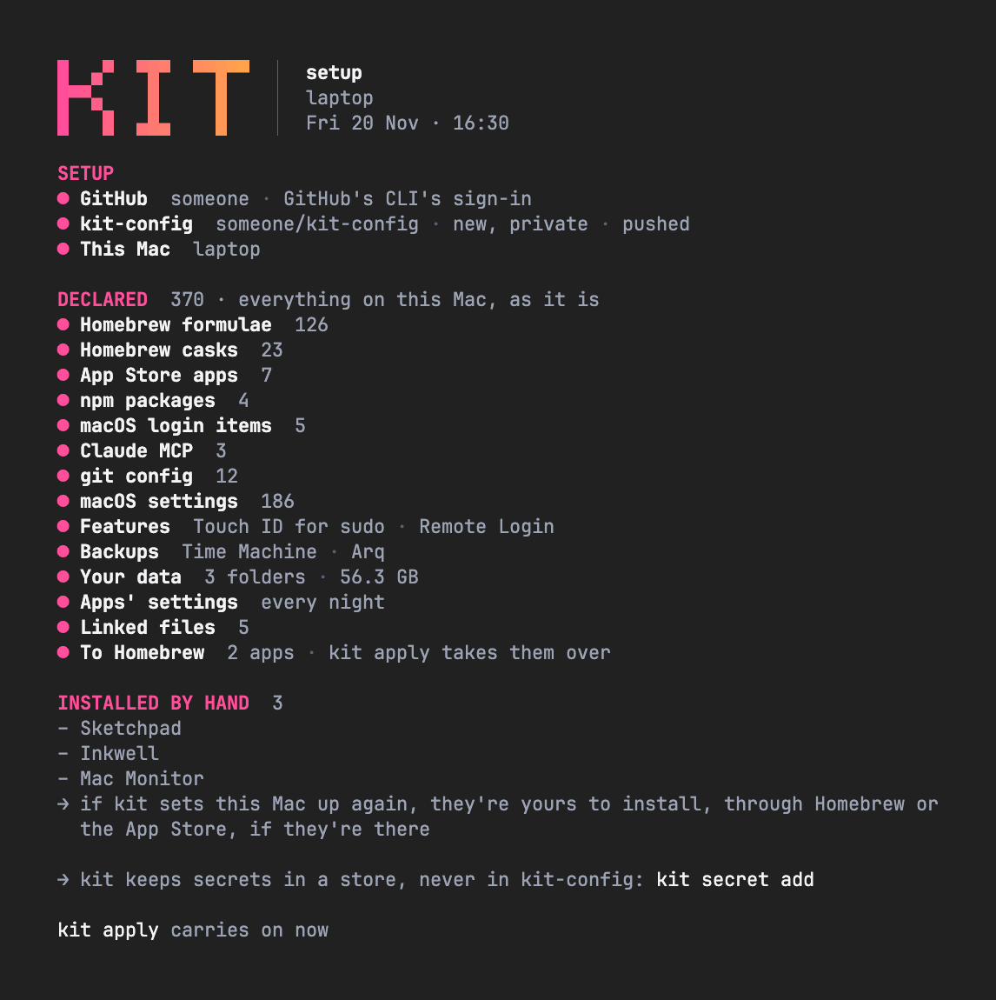

# Your first kit-config, from the Mac you use

`kit setup` brings the Mac you use today onto kit in one command. It makes a private
kit-config on GitHub and declares everything the Mac has, as it stands. Then it commits, pushes
and runs `kit apply`. You'd run it on a Mac that's already set up, before kit looks after it.

## Try it

```bash
# Install kit through Homebrew
brew install leeovery/tools/kit
# Bring this Mac onto kit
kit setup
```

`kit setup` signs you in to GitHub and asks a few questions. It ends on what it declared, then
hands over to `kit apply`:



On a blank Mac, use the one-line install instead: see [A new Mac from one line](new-mac.md).

## What it asks

Each question comes with a suggested answer, so enter takes it. Each has a flag too:

| Question | Suggested | Flags |
|---|---|---|
| kit-config | Create it, or join yours | `--create`, `--join` |
| This Mac | A name from its model | `--mac` |
| Your data | Your own folders | `--restore`, `--no-restore` |
| Apps' settings | Save every night | `--prefs`, `--no-prefs` |
| Linked files | Your shell's files | `--link`, `--no-link` |
| To install, joining | Install with the rest | `--apply`, `--no-apply` |

- **Your data** lists the folders in your home folder, with their sizes. A new Mac copies the
  ones you keep from your backups. Downloads, Movies, Music and Public start unticked.
- **Apps' settings** switches on a save every night, which a new Mac restores from. See
  [Apps' settings](apps-settings.md).
- **Linked files** lists files such as `~/.zshrc` and `~/.ssh/config`. Each one you keep moves
  into kit-config and is linked back.

## What it declares

The snapshot declares the Mac as it stands, in this Mac's own declarations file:

- every package of each kind whose program is on the Mac, such as Homebrew casks;
- the macOS settings set now, leaving out the state macOS keeps for itself;
- git's global settings;
- the features on, such as Touch ID for sudo;
- the backup tools set up, Time Machine or Arq.

Your answers are declared beside the snapshot. kit commits all of it as one, and pushes it.

## What it leaves out

- **Apps installed by hand** are listed, never managed. If kit sets this Mac up again, you
  install them yourself.
- **Secrets** aren't looked for. kit keeps a secret in a store, never in kit-config: declare
  each one with `kit secret add`. See [Secrets from 1Password](secrets.md).
- **A package from a private tap** needs its token declared as a secret first. Until then, kit
  refuses its line and says why.

## Running it again

If setup stops part-way, run `kit setup` again. It carries on where it stopped, and nothing is
made twice. Bare `kit` at a terminal offers the same. Before the commit, a new flag replaces the
answer you gave. Once the commit is pushed, setup is done.

## A second Mac joins

On your next Mac, `kit setup` finds kit-config on your account and offers to join it. Then
pick which Mac this is, or a new one. A new Mac starts empty, or as a copy of another with
`--from`.

```bash
# Join kit-config as a new Mac named studio
kit setup --join owner/kit-config --mac studio
```

kit then asks about what kit-config declares that this Mac hasn't. Install it with the rest,
or stop to look first with `kit status`.

## Good to know

- **kit-config must be private.** `--join` refuses a repository that isn't.
- **A Mac with a kit-config already** is refused: kit looks after it already.
- **Without a terminal, kit asks nothing.** A question its flag doesn't answer stops setup,
  naming the flag, and exits 2.
- **Never delete `~/.config/kit` part-way.** Setup moves files into it and links them back.

## Reference

| Flag | What it answers |
|---|---|
| `--create <name>` | Make kit-config, private, on your account |
| `--join owner/name` | Join a kit-config you have |
| `--mac <name>` | This Mac's name |
| `--from <mac>` | The Mac a new one copies |
| `--restore <path>` | A folder a new Mac brings back |
| `--prefs` | Save apps' settings every night |
| `--link <path>` | A file kit-config keeps, linked back |
| `--no-apply` | Stop after the commit, to look first |

`--restore` and `--link` take one path each time. `--restore`, `--prefs` and `--link` each
have a `--no-` flag that answers no. `kit setup --help` lists every flag.

## Related

- [A new Mac from one line](new-mac.md)
- [Packages: install once, and your next Mac has it](packages.md)
- [Glossary](glossary.md)
