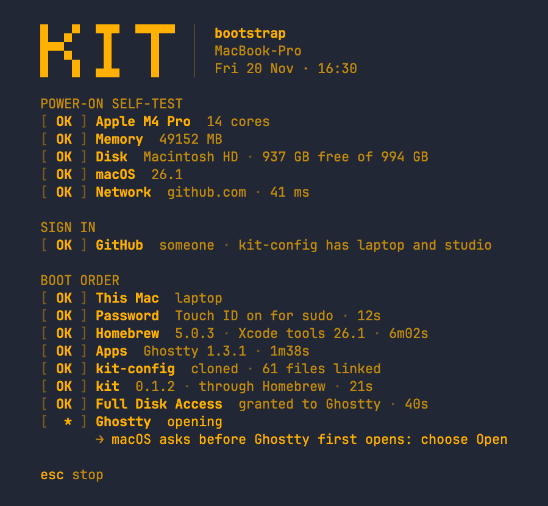
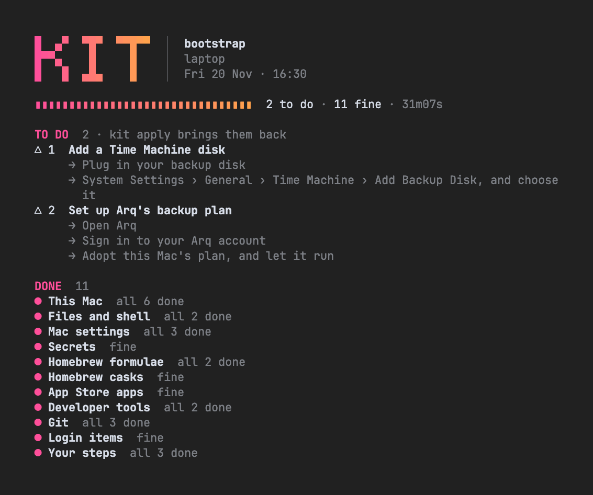

# A new Mac from one line

Paste one line into Terminal on a blank Mac, and kit sets it up from kit-config. You sign in to
GitHub on your phone, pick which Mac this is, and type your password once. kit installs the
rest, then carries on in your own terminal. You'd use it on every Mac you set up.

The line reads the repository named `kit-config` in your GitHub account. If you don't have one
yet, see [Your first kit-config](first-config.md). To copy from one of your Macs, ready it first.
Then make your user in macOS's own setup with the same user name as that Mac.
[Your data on a new Mac](your-data.md) says how.

## Try it

```bash
# On the new Mac, in Terminal
/bin/bash -c "$(curl -fsSL \
https://raw.githubusercontent.com/leeovery/kit/main/install.sh)"
```

The line downloads the newest release of kit, checks it against its checksum, and runs
`kit bootstrap`. A splash plays while kit tests the Mac, then enter starts the boot. The end of
the boot looks like this:



## The boot, step by step

1. **GitHub.** Press enter for a QR code to scan with your phone, or `s` for the browser here.
   kit reads kit-config, which must be private.
2. **This Mac.** Pick one of the Macs kit-config names, or `new`. A new Mac gets a name, then
   starts fresh or as a copy of one of your Macs.
3. **Password.** Typed once, for everything the boot installs.
4. **Homebrew,** with Apple's command line tools.
5. **Apps.** The terminal `kit.toml` names, such as Ghostty: `kit terminal` sets it.
6. **kit-config.** Cloned to `~/.config/kit`, its files linked into your home folder.
7. **kit,** installed through Homebrew, so it stays up to date.
8. **Full Disk Access.** You drag the terminal into the list System Settings shows.
9. **The terminal.** It opens, and kit carries on there.

## What happens

- **`kit apply` runs on a screen of its own.** Rows show each part of the Mac, such as
  Homebrew casks, with what each waits for.
- **What waits for you comes up as a card,** such as signing in to 1Password, or a step by
  hand. kit carries on by itself once it's done.
- **A to-do list comes at the end:** steps by hand that nothing waits for, and set-up only you
  can do, such as a backup disk.
- **The window becomes a fresh shell** once `kit apply` ends.

`kit apply` ends on its record: what's left for you to do, then what's done.



## Which Mac it starts from

| You pick | Its declarations | Your data |
|---|---|---|
| `new`, from one of your Macs | A copy of that Mac's | From that Mac |
| A Mac added with `--from` | Its own | From that Mac |
| Any other Mac kit-config names | Its own | Its own backups, or none |
| `new`, fresh | Only `shared` | None |

`kit machine add studio --from laptop` adds `studio`, started from `laptop`. Pick `studio` at
the boot, and its first `kit apply` copies your data from `laptop`.

## What waits for what

kit installs nothing before what it needs is in place:

- npm packages wait for npm, from a formula;
- GitHub CLI extensions wait for `gh`, App Store apps for `mas`;
- MCP servers wait for `claude`, and skills for `agntc`;
- a line from a private tap waits for its token to sync;
- login items wait for the casks and App Store apps;
- MCP servers, skills and steps declared `--after restore` wait for the data restore.

App Store apps also need you signed in to the App Store, or their install fails. Declare that
sign-in as a step by hand, and give the `[app store apps]` header `--after` its name. See
[Steps of your own, and steps by hand](steps.md).

## Good to know

- **A failure is no dead end.** Paste the install line into Terminal again. The checks find
  the steps already done, and the boot picks up where it stopped.
- **After the boot, run `kit apply` again.** It installs what failed or waited, and never
  removes anything.

## Reference

| Command | What it does |
|---|---|
| `kit machine add <name> --from <mac>` | Adds a Mac, a copy of another |
| `kit apply` | Installs what's declared and missing |
| `kit bootstrap` | The boot, which the install line runs |

## Related

- [Your data on a new Mac](your-data.md)
- [Steps of your own, and steps by hand](steps.md)
- [Packages: install once, and your next Mac has it](packages.md)
