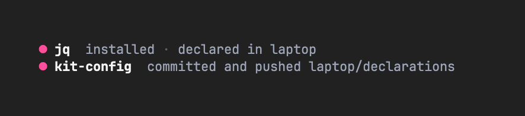
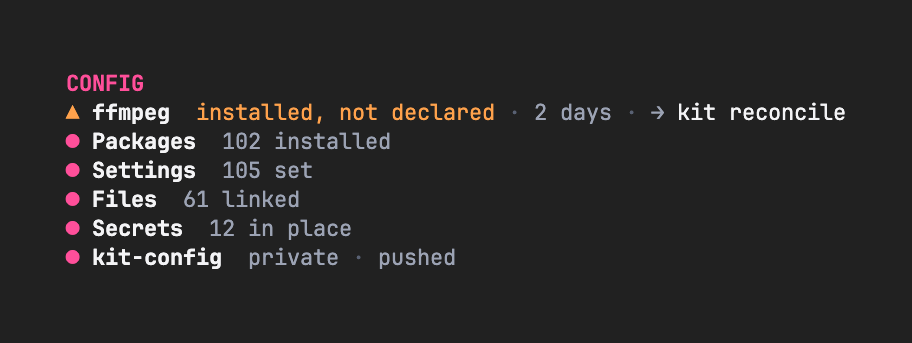

# Packages: install once, and your next Mac has it

One kit command installs a package and declares it in [kit-config](glossary.md). A Mac that
replaces this one installs it too, and `--shared` puts it on every Mac. You'd want it for every
install you mean to keep.

## Try it

```bash
# Install jq, and declare it for this Mac
kit brew add jq
```

kit installs jq, writes its line, then commits and pushes kit-config:



The line lands in this Mac's declarations file, sorted:

```text
[homebrew formulae]
jq
```

```bash
# Install it here, and declare it for every Mac
kit cask add firefox --shared --note "browser"
# Uninstall jq, and take its line out
kit brew remove jq
```

## The kinds kit installs

Each kind has a section in a declarations file, and an `add` and a `remove` command.

| Command | Section | Named as |
|---|---|---|
| `kit brew` | `[homebrew formulae]` | `jq`, `owner/tap/tool` |
| `kit cask` | `[homebrew casks]` | `firefox` |
| `kit mas` | `[app store apps]` | `xcode@497799835` |
| `kit npm` | `[npm packages]` | `typescript@5` |
| `kit composer` | `[composer packages]` | `vendor/pkg:^4.0` |
| `kit gh` | `[github extensions]` | `owner/gh-tool` |
| `kit login-item` | `[macos login items]` | a bundle id |
| `kit claude-mcp` | `[claude mcp]` | a server's name |
| `kit claude-skill` | `[claude skills]` | `owner/repo/skill` |

## What happens

- **This Mac only, unless you say.** Without `--shared`, the line goes in this Mac's file. With `--shared`, it goes in `shared/declarations` for every Mac,
  and comes out of each Mac's own file. Other Macs install it at their next `kit apply`.
- **Removing undoes the install.** A formula is uninstalled, a login item stops opening at
  login, and an MCP server leaves Claude Code. If something installed still needs the package,
  kit changes nothing and says why.
- **`kit apply` installs what's missing,** and never removes anything.
- **A new Mac installs it all,** once what each kind needs is in place, such as npm for npm
  packages. [A new Mac from one line](new-mac.md) says what waits for what.

## Lines copied from a README

```bash
# A README's line, with kit in front
kit brew install --cask owner/tap/tool
```

Homebrew runs the line as given, output and all. kit then declares each name it
installed, and pushes kit-config. kit takes these lines, and the uninstall of each:

- `brew install`
- `npm install -g`
- `mas install <id>`
- `gh extension install owner/gh-name`
- `composer global require`

Type `add` yourself, and put kit in front of a copied line. In the line:

- **Flags are for this install only.** kit-config keeps the names, with an npm version or a
  Composer constraint.
- **`--shared` and `--note` are kit's.** kit's other flags go first: `kit --plain brew install jq`.
- **One name kit can't declare refuses the line,** and nothing runs.
- **A cask line adopts the app already there,** as `kit cask add` does, unless a flag changes
  how it installs.

[Troubleshooting](troubleshooting.md) covers the lines kit refuses.

## Your own installs show up

A package you install with brew or npm yourself is drift. After its first day, `kit status` lists it under CONFIG:



`kit reconcile brew:ffmpeg --adopt` declares it, and `--remove` uninstalls it.

Apps you dragged into Applications show up too, if kit can match them to a cask. Adopting one
has Homebrew take the app over: see [Troubleshooting](troubleshooting.md) if it fails. `--leave` keeps the app by hand.

## Good to know

- **Removing an app asks about its files.** `kit cask remove` and `kit mas remove` ask at a
  terminal whether to keep what the app leaves behind. `--keep` and `--zap` answer without
  asking. Without a terminal, kit keeps it.
- **Trying something out?** `--temp` installs without declaring, quiet for 7 days.
- **Private taps need a token.** kit checks a tap's download as you add it. If it's private, the
  line waits on a secret: see [Secrets from 1Password](secrets.md).
- **Installing isn't setting up.** A sign-in or a licence a package needs is a
  [step of your own](steps.md) or a step by hand, after the package.

## Reference

| Command or flag | What it does |
|---|---|
| `kit <kind> add <name>...` | Install, and declare for this Mac |
| `add --shared` | Declare for every Mac instead |
| `add --note "<why>"` | Keep why, after the name |
| `kit <kind> install <line>` | Run a copied line, then declare |
| `kit <kind> remove <name>...` | Uninstall, and undeclare |
| `remove --shared` | Needed to remove a shared line |
| `kit list [<kind>]` | List what's declared for this Mac |
| `kit why <name>` | Where it's declared, and what needs it |

Each takes `--json`, and `--help` says what it changes.

## Related

- [Drift: keep or undo what changed by hand](drift.md)
- [Secrets from 1Password](secrets.md)
- [A new Mac from one line](new-mac.md)
