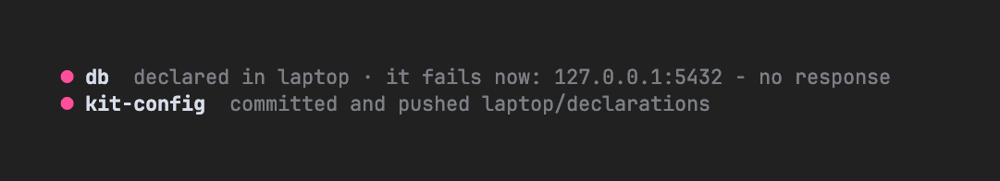

# Running by itself: kit checks your Mac every hour

Every hour, kit runs your hourly jobs, then checks the whole Mac. Once a night it also saves
your apps' settings and runs your nightly jobs. It tells no one what it finds, so nothing
interrupts you. You look when you choose, with `kit status`. `kit apply` sets it up on every
Mac.

## Try it

```bash
# Say what's due now, and run nothing
kit nightly --plan
# Run what's due, then every check
kit nightly
# Say when the runs last ran
kit status nightly
```

You don't need to run `kit nightly` yourself. On the hour, launchd opens kit.app, and kit.app
runs `kit nightly`. `kit apply` installs that launch and builds kit.app.

## Jobs of your own

A job is a command kit runs on a schedule. Declare one in `[hourly]` or `[nightly]`:

```bash
# Every hour: quoted, so kit writes ~ itself
kit hourly add notes -- '~/bin/sync-notes'
# Every night
kit nightly add tidy -- tidy-up --all
```

```text
[hourly]
notes -- ~/bin/sync-notes

[nightly]
tidy -- tidy-up --all
```

kit reads a `~/` at the start of a word as your home folder when the job runs. Quote it, or
your shell writes your full home path into the line.

For example, a nightly job can clear a scratch folder of files untouched for a week. kit clears none of your folders: a job like that is yours.

## What each run does

| Every hour | Once a night |
|---|---|
| Your `[hourly]` jobs | Your `[nightly]` jobs |
| Restores apps' settings that wait for their apps | Saves your apps' settings |
| Every check, as `kit status` | |

- **The nightly run comes at 03:00,** unless you move it: `kit nightly at 04:30` sets
  `nightly_at` in `kit.toml`. A Mac asleep then runs it at the first hourly run after it wakes.
- **Jobs run one at a time, in order.** One that fails never stops the others. Each may run for
  an hour.
- **It brings in what your other Macs pushed.** Each run pulls kit-config first, so a change
  made on one Mac shows on the others within the hour. Edits you haven't committed stay as they
  are. If the pull can't happen, the run carries on, and `kit status` says why.
- **It installs nothing and removes nothing.** The one thing it puts right is a new folder that
  matches your backup exclusions: kit keeps it out of the backups.
- **Settings need a feature on.** Without `kit feature on prefs`, the runs save and restore
  no settings: see [apps' settings](apps-settings.md).

## Checks of your own

A check is a command that exits 0 when all's well. Declare it in `[checks]`, and kit runs it on
every `kit status` and every hourly run. kit runs it once when you add it:

```bash
# Check the local database answers
kit check add db -- pg_isready -h 127.0.0.1
```



If a check fails, the first line it prints is what `kit status` shows. A check must change
nothing, and finish within a minute.

## kit.app needs Full Disk Access

The hourly run goes through kit.app. kit.app needs Full Disk Access to save apps' settings and
read Time Machine's state. A whole `kit apply` at a terminal asks for it with a card, "Give
kit.app Full Disk Access". The card opens System Settings at Full Disk Access, and Finder at
kit.app. Its step says "Drag kit.app into the list, and switch it on".

The next hourly run checks it. A new build of kit.app needs it given again: remove the old one
from the list with −, then drag kit.app in.

## Nothing tells you: you look

The runs post no notification and send no message. `kit status` shows what they found, and
flags the runs themselves:

- no hourly run in the last two hours;
- no nightly run finished in the last 26 hours, if the Mac has nightly jobs or saves apps' settings;
- a job that failed, and what it said.

`kit nightly <job>` runs a failed job again, and `kit log` shows each run whole.

## Good to know

- **It runs the kit you run.** The launch runs the kit on kit's PATH, so a Homebrew upgrade
  carries on.
- **A Mac without the launch says so.** `kit status` flags a Mac that has never run on a
  schedule. `kit apply` puts the launch in place.

## Reference

| Command | What it does |
|---|---|
| `kit nightly` | Run the jobs due, then every check |
| `kit nightly --plan` | Say what's due, and run nothing |
| `kit nightly <job>...` | Run only those jobs, now |
| `kit nightly at [<time>]` | Show or set when the nightly run falls due |
| `kit hourly add <name> -- <cmd>` | Declare an hourly job |
| `kit nightly add <name> -- <cmd>` | Declare a nightly job |
| `kit check add <name> -- <cmd>` | Declare a check, and run it once |
| `kit status nightly` | When the runs last ran, and how |

Each `add` has a `remove`, takes `--shared` for every Mac, and `--note` for why.

## Related

- [Steps of your own](steps.md)
- [Drift: keep or undo what changed by hand](drift.md)
- [Backups](backups.md)
