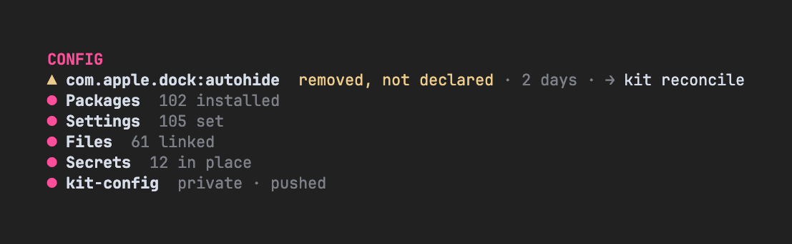

# macOS settings: set once, kept on every Mac

Change a setting in System Settings as you always do, then tell kit to keep it. kit reads the
value this Mac has and declares it in kit-config, and each Mac it's declared for gets it.
kit also watches the Dock, Finder, the trackpad and more, so a change you forgot still
turns up. `kit power` and `kit git-config` keep power and git settings the same way. kit watches
every git setting, but only the power settings you declare.

## Try it

```bash
# Resize the Dock in System Settings, then keep it
kit defaults add com.apple.dock:tilesize
```

kit reads the value and writes the line in the form `defaults write` takes:

```text
[macos settings]
com.apple.dock tilesize -int 48
```

```bash
# Keep the charger's sleep setting, for every Mac
kit power add charger:sleep --shared
# Keep how git pulls
kit git-config add pull.rebase
```

Each lands in its own section, in sorted order, then kit commits and pushes kit-config. The
power setting goes in `shared/declarations`:

```text
[power settings]
-c sleep 0
```

The git setting goes in this Mac's file, `laptop/declarations`:

```text
[git config]
pull.rebase true
```

## What happens

- **`kit apply` sets what's missing.** On a new Mac, or for a line you wrote by hand, kit writes
  the declared value.
- **You see the change at once.** After kit changes a setting, it restarts what
  shows it, such as the Dock, Finder, Control Center or the menu bar, and reloads keyboard shortcuts.
- **A change by hand is never undone behind your back.** If a declared setting changes on the
  Mac, `kit apply` leaves it. It's drift: you keep the new value or put back the
  declared one.
- **Removing differs by kind.** `kit defaults remove` and `kit git-config remove` unset the
  setting. `kit power remove` only takes the line out, and the value stays.

## Changes in Apple's settings show up

kit watches these domains, and every domain you declare a setting in:

- the Dock, Finder, Spaces and Stage Manager;
- the trackpad, the keyboard and keyboard shortcuts;
- screenshots, the menu bar clock and Control Center;
- whether Finder leaves `.DS_Store` files on other drives;
- the global domain, which holds settings for every app.

The first time kit looks at a domain, it takes the values as they are. After that, a setting
you change there and haven't declared is drift. After a day, `kit status` lists it, and `kit
reconcile` asks whether to declare it or put it back.

A setting you never declared, removed from the Mac, shows up the same way:



`kit reconcile defaults:com.apple.dock:autohide --adopt` accepts it as removed, and kit stops
showing it. `--revert` puts the old value back.

## What macOS changes by itself is ignored

macOS writes some values on its own. kit ignores them, so they never show up as
drift:

- window sizes and positions, and the columns of a table;
- recent files, folders and places;
- timestamps and dates;
- the apps in the Dock, and Finder's views of the Trash and the network.

git is different: every global setting that kit-config doesn't declare shows up.

## Good to know

- **A name that starts `currentHost:`** is a setting macOS keeps for each Mac apart. For
  example, `currentHost:NSGlobalDomain:com.apple.mouse.tapBehavior` writes a line starting
  `-currentHost`. It can still be declared for every Mac.
- **Some settings need your password.** A setting in a domain under `/Library`, and every
  power setting, is written through sudo. `kit apply` asks for the password once, at a terminal.
- **An app keeps its own settings elsewhere.** A setting in the domain of an app is saved with
  the rest of that app: see [Apps' settings](apps-settings.md).
- **Remote Login, File Sharing, Screen Sharing and Touch ID for sudo** are features, switched
  on with `kit feature on`. kit checks Screen Sharing viewers can take control,
  which only System Settings grants: a whole `kit apply` at a terminal opens it.

## Reference

| Command or flag | What it does |
|---|---|
| `kit defaults add <domain:key>...` | Keeps macOS settings |
| `kit power add <source:setting>...` | Keeps power settings |
| `kit git-config add <key>...` | Keeps git settings |
| `add --shared` | Declares it for every Mac |
| `add --note "<why>"` | Keeps why, after the line |
| `kit <kind> remove <name>...` | Takes the line out, as above |
| `remove --shared` | Needed to remove a shared line |
| `kit reconcile` | Settles what changed by hand |

A power source is `charger`, `battery`, `all` or `ups`. Each command takes `--json`, and
`--help` says what it needs and what it changes.

## Related

- [Drift: keep or undo what changed by hand](drift.md)
- [Apps' settings](apps-settings.md)
- [Packages: install once, and your next Mac has it](packages.md)
