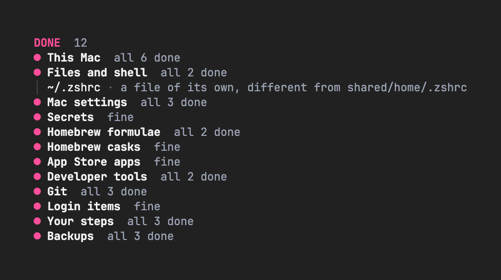

# Troubleshooting: what kit's messages mean, and the fix

Each entry starts from what kit says, then gives the cause and the fix. Most messages name the
command that puts things right, so read the whole line first.

## "no config repository"

```console
kit: no config repository: no kit.toml in /Users/someone/.config/kit: set this Mac up with kit setup, clone your config repository to /Users/someone/.config/kit, or point KIT_CONFIG at it
```

**Cause:** kit found no `kit.toml` in the folder it reads kit-config from, so it stops.

**Fix:** if kit doesn't look after this Mac yet, run `kit setup`. If it does, clone kit-config
into the folder the message names:

```bash
# Clone kit-config where kit looks for it
gh repo clone owner/kit-config ~/.config/kit
```

`KIT_CONFIG` can point kit at a clone somewhere else, but it reaches only the shell that sets
it. The hourly run still reads the folder the message names, so prefer the clone.
[Configuration](configuration.md) says where kit looks.

## kit-config is public

The boot stops with:

```text
owner/kit-config is public on GitHub, and a config repository is always private: make it private, then boot again
```

On a Mac in use, `kit status` says so under CONFIG:

```text
public on GitHub (owner/kit-config): it must be private
```

`kit status` also shows the command that makes it private:


**Cause:** kit-config names your Macs, apps and where your secrets are kept, so kit insists it
stays private.

**Fix:** make it private on GitHub, then boot again or run `kit status`:

```bash
gh repo edit owner/kit-config \
  --visibility private \
  --accept-visibility-change-consequences
```

If `kit status` says it `can't prove` kit-config private, the remote isn't a github.com URL
kit reads. The message lists the forms kit reads.

## An install waits for a password

```text
waiting for an administrator's password: kit apply at a terminal asks for it
needs an administrator's password: run kit apply at a terminal
```

**Cause:** some installs need an administrator's password:

- a cask that installs through a package;
- an App Store app;
- some macOS and power settings;
- backup and Spotlight exclusions;
- a step declared `--sudo`.

kit asks for the password only at a terminal. The hourly run, an agent and a run with `--json`
or `--plain` have nobody to ask, so those items wait. The rest of the run carries on.

**Fix:** run `kit apply` at a terminal. kit asks for the password once, as the run starts. To
apply one step, name it, such as `kit apply fonts`.

## 1Password's approval timed out

The secrets step says `1Password wasn't approved, or couldn't read them`. Then it gives what
1Password said, and how to have it answer.

**Cause:** 1Password asks you to approve a read of your secrets once its last approval has
lapsed. kit waits up to 10 minutes for that answer. If nobody approves in time, kit holds back the secrets it hasn't
read until the next sync. Whatever waits on them waits too.

**Fix:**

1. Unlock the 1Password app.
2. Turn on Settings › Developer › Integrate with 1Password CLI.
3. Run `kit secret sync`, and approve the prompt.

If kit says 1Password isn't signed in, and both are done, quit 1Password and open it again.
Over a remote connection, sign in with a password in the shell kit runs from, as the message
says.

## App Store apps don't install

```text
couldn't install bear@1091189122, numbers@409203825, xcode@497799835: no one's signed in: sign in to the App Store, then try again
```

The message may say `the App Store didn't answer` instead.

**Cause:** an App Store install needs someone signed in to the App Store. kit can't sign you in.

**Fix:** open the App Store app, sign in, then run `kit apply mas`.

On a new Mac, declare the sign-in as a [step by hand](steps.md) that comes before the App Store
apps. Write `--before mas` on its line in `[manual]`:

```text
[manual]
app-store "Sign in to the App Store" --before mas
```

kit then asks for the sign-in partway through the run. If an install still finds nobody signed
in, kit asks again on the next run.

## kit.app needs Full Disk Access again

`kit status` shows the step `kit-app-access` as `not given to this build of kit.app`.

**Cause:** the hourly run goes through kit.app, which needs Full Disk Access. When an update
changes kit.app, kit builds it again. macOS treats the new build as another app, and the old
grant doesn't carry over.

**Fix:** run `kit apply` at a terminal, with no step named. It opens System Settings at Full
Disk Access, and Finder at kit.app. Then:

1. Remove the old kit.app from the list, with −.
2. Drag the new kit.app into the list, and switch it on.
3. Say so on kit's card.

The next hourly run checks the grant.

## A linked file differs

`kit apply` leaves the file as it is, and says so under Files and shell in its record:



**Cause:** something replaced the link with a file of its own. An app that saves by writing a
new file does this. kit never overwrites it, because the two differ.

**Fix:** keep one copy with `kit reconcile`:

```bash
# Keep this Mac's copy: it goes into kit-config
kit reconcile file:~/.zshrc --adopt
# Keep kit-config's: this Mac's goes to the Bin
kit reconcile file:~/.zshrc --revert
```

Either way, kit links the file again. At a terminal, `kit reconcile` asks about each one.
[Linked files](linked-files.md) says more.

## Related

- [Commands](commands.md)
- [Configuration](configuration.md)
- [Drift: keep or undo what changed by hand](drift.md)
