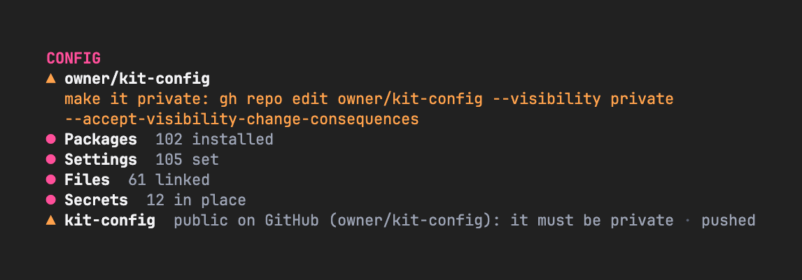

# Troubleshooting: what kit's messages mean, and the fix

Each entry starts from what kit says, then gives the cause and the fix. Most messages name the
command that puts things right, so read the whole line first.

## "no config repository"

```console
kit: no config repository: no kit.toml in /Users/someone/.config/kit: set this Mac up with kit setup, clone your config repository to /Users/someone/.config/kit, or point KIT_CONFIG at it
```

**Cause:** kit found no `kit.toml` in the folder it reads kit-config from, so it stops.

**Fix:** if kit doesn't look after this Mac yet, run `kit setup`. If it does, clone kit-config
into the folder the message names:

```bash
# Clone kit-config where kit looks for it
gh repo clone owner/kit-config ~/.config/kit
```

`KIT_CONFIG` can point kit at a clone somewhere else, but it reaches only the shell that sets
it. The hourly run still reads the folder the message names, so prefer the clone.
[Configuration](configuration.md) says where kit looks.

## kit-config is public

The boot stops with:

```text
owner/kit-config is public on GitHub, and a config repository is always private: make it private, then boot again
```

On a Mac in use, `kit status` says so under CONFIG:

```text
public on GitHub (owner/kit-config): it must be private
```

`kit status` also shows the command that makes it private:



**Cause:** kit-config names your Macs, apps and where your secrets are kept, so kit insists it
stays private.

**Fix:** make it private on GitHub, then boot again or run `kit status`:

```bash
gh repo edit owner/kit-config \
  --visibility private \
  --accept-visibility-change-consequences
```

If `kit status` says it `can't prove` kit-config private, the remote isn't a github.com URL
kit reads. The message lists the forms kit reads.

## An install waits for a password

```text
waiting for an administrator's password: kit apply at a terminal asks for it
needs an administrator's password: run kit apply at a terminal
```

**Cause:** some installs need an administrator's password:

- a cask that installs through a package;
- an App Store app;
- some macOS and power settings;
- backup and Spotlight exclusions;
- a step declared `--sudo`.

kit asks for the password only at a terminal. The hourly run, an agent and a run with `--json`
or `--plain` have nobody to ask, so those items wait. The rest of the run carries on.

**Fix:** run `kit apply` at a terminal. kit asks for the password once, as the run starts. To
apply one step, name it, such as `kit apply fonts`.

## 1Password's approval timed out

The secrets step says `1Password wasn't approved, or couldn't read them`. Then it gives what
1Password said, and how to have it answer.

**Cause:** 1Password asks you to approve a read of your secrets once its last approval has
lapsed. kit waits up to 10 minutes for that answer. If nobody approves in time, kit holds back the secrets it hasn't
read until the next sync. Whatever waits on them waits too.

**Fix:**

1. Unlock the 1Password app.
2. Turn on Settings › Developer › Integrate with 1Password CLI.
3. Run `kit secret sync`, and approve the prompt.

If kit says 1Password isn't signed in, and both are done, quit 1Password and open it again.
Over a remote connection, sign in with a password in the shell kit runs from, as the message
says.

## App Store apps don't install

```text
couldn't install bear@1091189122, numbers@409203825, xcode@497799835: no one's signed in: sign in to the App Store, then try again
```

The message may say `the App Store didn't answer` instead.

**Cause:** an App Store install needs someone signed in to the App Store. kit can't sign you in.

**Fix:** open the App Store app, sign in, then run `kit apply mas`.

On a new Mac, declare the sign-in as a [step by hand](steps.md) that comes before the App Store
apps. Write `--before mas` on its line in `[manual]`:

```text
[manual]
app-store "Sign in to the App Store" --before mas
```

kit then asks for the sign-in partway through the run. If an install still finds nobody signed
in, kit asks again on the next run.

## A cask fails because its app is already there

```text
couldn't install spaceman: Spaceman.app is already in /Applications and isn't the cask's (com.example.Spaceman)
```

The message may end `and is the App Store's` instead.

**Cause:** an app of the cask's name is in Applications, but the cask doesn't name its bundle
id. A fork with the same name does this, and so does the App Store's copy. kit leaves that app
alone rather than replace it.

**Fix:** choose which copy you keep.

- To keep the cask's, move the app to the Bin or rename it, then run `kit apply cask`.
- To keep yours, run `kit reconcile cask:spaceman --undeclare`. The app stays installed by
  hand. If the cask is declared for every Mac, add `--shared`.

## kit.app needs Full Disk Access again

`kit status` shows the step `kit-app-access` as `not given to this build of kit.app`.

**Cause:** macOS sees another kit.app than the one you gave access to. Releases ship kit.app
signed, so updates keep the grant. Two things change kit.app all the same:

- the first update that ships kit.app replaces the kit.app your Mac built;
- a kit you built yourself builds kit.app from changed files.

macOS treats the new kit.app as another app, and the old grant doesn't carry over.

**Fix:** run `kit apply` at a terminal, with no step named. It opens System Settings at Full
Disk Access, and Finder at kit.app. Then:

1. Remove the old kit.app from the list, with −.
2. Drag the new kit.app into the list, and switch it on.
3. Say so on kit's card.

The next hourly run checks the grant.

## Backup exclusions wait for Full Disk Access

The Mac settings row of `kit apply` says `needs Full Disk Access`. Its To do lists "Give
Ghostty Full Disk Access, then reopen it", with your terminal's name.

**Cause:** `tmutil` changes Time Machine's list only for an app with Full Disk Access. The
terminal kit runs in doesn't have it, and a terminal takes up the access only once it's
reopened.

**Fix:** follow the to-do's steps:

1. In System Settings › Privacy & Security › Full Disk Access, turn on your terminal.
2. Quit the terminal and open it again.
3. Run `kit apply backup-exclusion`.

Over SSH, the to-do is "Allow Full Disk Access for remote users" instead. You find that switch
in System Settings › General › Sharing › Remote Login › ⓘ.

## A linked file differs

`kit apply` leaves the file as it is, and says so under Files and shell in its record:


**Cause:** something replaced the link with a file of its own. An app that saves by writing a
new file does this. kit never overwrites it, because the two differ.

**Fix:** keep one copy with `kit reconcile`:

```bash
# Keep this Mac's copy: it goes into kit-config
kit reconcile file:~/.zshrc --adopt
# Keep kit-config's: this Mac's goes to the Bin
kit reconcile file:~/.zshrc --revert
```

Either way, kit links the file again. At a terminal, `kit reconcile` asks about each one.
[Linked files](linked-files.md) says more.

## Your other Mac's changes don't come in

`kit status` shows a row under CONFIG that starts with this, then says why:

```text
the remote's commits not brought in
```

**Cause:** each run pulls kit-config before it reads it, and this pull couldn't happen. kit
pulls only if it can leave your edits and commits as they are. Being offline stops the pull
too. The row stays grey for a day, then needs you.

**Fix:** if you're offline, do nothing: the next run tries again. Otherwise, do what the row
says. Each reason ends with what to do:

| The row says | What to do |
|---|---|
| change what's not committed | See the next section |
| conflict with this Mac's | See the next section |
| which git ignores | Move that file aside |
| set aside what's not committed | Commit or undo the edit |
| pulling would delete | Commit or undo the change |
| is under way | Finish it, or abort it |
| is waiting to be resolved | Resolve the conflict |
| git signs its commits | Pull and push by hand |
| history was rewritten | See the last section |

To pull and push by hand, run `git -C ~/.config/kit pull --rebase`, then
`git -C ~/.config/kit push`. git signs each commit it rebases as it goes.

### You and the other Mac changed one file

To keep the other Mac's change, undo yours:

```bash
# Put the file back as last committed
kit reconcile config:laptop/declarations --revert
```

To keep both changes, commit yours, then bring theirs in by hand. If the row says "conflict
with this Mac's", yours is committed already: start at the pull. The pull stops on the conflict
and leaves git's markers in the file:

```bash
# Commit your edit
kit reconcile config:laptop/declarations --adopt
# Bring theirs in: it stops on the conflict
git -C ~/.config/kit pull --rebase --autostash
```

Edit the file to keep what you want from both, and remove the markers. Then finish. If
`rebase --continue` opens your editor with the commit message, save and close it:

```bash
# Mark the file resolved, then carry on
git -C ~/.config/kit add laptop/declarations
git -C ~/.config/kit rebase --continue
```

Then push the result:

```bash
git -C ~/.config/kit push
```

### Another Mac rewrote kit-config's history

Another Mac force-pushed kit-config, dropping a commit this Mac still has. kit won't put that
commit back. First, list the commits here that the remote doesn't have, newest first:

```bash
git -C ~/.config/kit log --oneline @{u}..
```

The list holds the commits the other Mac dropped, and any of yours not pushed yet. If none of
them is yours, match the remote. Your edits that aren't committed stay:

```bash
git -C ~/.config/kit reset --keep @{u}
```

If that says `not uptodate`, an edit touches a dropped file: commit or undo the edit, then run
it again.

If some of them are yours, keep those and leave the dropped ones out. Name the newest dropped
commit from the list, here `1a2b3c4`. Your commits above it in the list stay:

```bash
git -C ~/.config/kit rebase --autostash \
  --onto @{u} 1a2b3c4
git -C ~/.config/kit push
```

## Related

- [Commands](commands.md)
- [Configuration](configuration.md)
- [Drift: keep or undo what changed by hand](drift.md)
