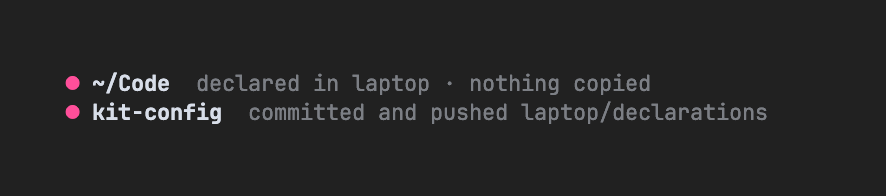

# Your data on a new Mac

kit rebuilds your apps and settings from kit-config, but your own data isn't there: code,
shell history, the state your tools keep. The restore list names those paths. A new Mac copies
them from the Mac it started from, or from a backup. You'd want it before moving to a new
Mac, or reinstalling this one.

## Try it

```bash
# Carry ~/Code across, without its caches
kit restore add ~/Code --skip 'cache/*'
# Carry shell history across, for every Mac
kit restore add ~/.zsh_history --shared
```

kit declares the path, and copies nothing now:



The line lands under `[restore]`, in `laptop/declarations`:

```text
[restore]
~/Code --skip cache/*
```

`--skip` names what in the path to leave out, relative to the path: a path, or a pattern as
rsync takes one. Quote a pattern, so your shell leaves it for kit.

## What happens

- **The data restore runs in the first `kit apply`** on a Mac the boot has just set up.
- **It waits for rsync 3 from Homebrew.** Copying from the old Mac, it waits for your secrets
  too.
- **Little waits for it:** only Claude Code's MCP servers and skills, and steps declared
  `--after restore`.
- **Nothing here is lost.** What a listed path holds already is set aside in kit's state,
  never deleted.
- **Projects get their dependencies** from their lockfiles: Composer, npm, pnpm, Yarn, Bun or
  uv. Yarn Berry, Go, Cargo, Swift and Terraform projects are left alone.
- **A stopped restore carries on** at the next `kit apply`.

## Where the data comes from

| This Mac | Copies from |
|---|---|
| Started from another Mac | That Mac, over SSH |
| Reinstalled under its own name | Its own backups |
| Started fresh, or in use | Nothing, unless you ask |

On a Mac reinstalled under its own name, a card asks for a Time Machine disk or Arq. The card
also offers to restore nothing, for a Mac already in use or starting afresh.

## Copying from the old Mac

`kit.toml` records the local hostname
and the SSH host key of the old Mac. The new Mac copies only from the Mac that presents that
key, at that name. Ready the old Mac first:

- Turn Remote Login on, with `kit feature on remote-login`. The next `kit apply` on the old Mac
  records its host key and local hostname in kit-config.
- Turn on "Allow full disk access for remote users", in Remote Login's settings.
- Add to its `~/.ssh/authorized_keys` the public half of the SSH key kit-config puts on the new
  Mac as a [secret](secrets.md). That's why the copy waits for secrets.
- Declare Homebrew's rsync for both Macs: `kit brew add rsync --shared`.
- Make the user on the new Mac with the same user name and home folder.

On the first copy, macOS asks whether your terminal may find devices on local networks. Choose
Allow: the copy fails until you do. If the old Mac doesn't answer, a card offers its Time
Machine disk, a restore through Arq by hand, or trying the Mac again.

## What it leaves out by itself

kit brings some things back itself. `kit restore add` refuses a path
that's one of these, or inside one:

- what kit links, what prefs saves, and what a kind puts in place, such as Claude skills;
- kit's own folders;
- what `[backup exclusions]` leaves out.

The copy also leaves out the `.DS_Store` and `.localized` files Finder makes. From the old Mac,
it leaves out folders excluded from its backups, unless one holds a git checkout.

## Good to know

- **A Mac in use restores nothing by itself.** `kit apply --restore-from` brings a path later,
  and only while the path is absent or empty. A path holding data is never touched.
- **`mac` works only on a Mac started from another.** `time-machine` and `arq` work anywhere.
- **Without a terminal, there's no card.** The restore fails until `--restore-from` names
  `mac`, `time-machine` or `arq`.

## Reference

| Command or flag | What it does |
|---|---|
| `kit restore add <path>` | Declares a path for this Mac |
| `add --skip <what>` | Leaves out what's in the path |
| `add --shared` | Declares it for every Mac |
| `kit restore remove <path>...` | Takes paths off the list |
| `kit apply --restore-from <src>` | Restores from `mac`, `time-machine` or `arq` |
| `apply --at <date>` | The latest backup by that date |
| `kit apply reinstall` | Retries the reinstalls that failed |

## Related

- [A new Mac from one line](new-mac.md)
- [Backups that kit checks](backups.md)
- [Secrets from 1Password](secrets.md)
